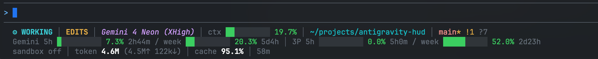

<p align="center">
  
</p>

<h1 align="center">Statusline HUD</h1>

<p align="center">
  English | <a href="./README.zh-CN.md">简体中文</a>
</p>

<p align="center">
  A multi-line terminal statusline and interactive <code>/hud</code> plugin for <a href="https://antigravity.google/docs/cli/statusline">Antigravity CLI (<code>agy</code>)</a>.
</p>

> [!NOTE]
> Targets **Antigravity CLI (`agy`)** on Linux, macOS, and WSL. Desktop app sessions and IDE extensions do not render custom TUI status lines.



## Quick Start

Requires `agy`, `bash` 3.2+, `jq` 1.6+, and optional `git`.

1. **Install the plugin**

   ```bash
   agy plugin install https://github.com/linbo0518/antigravity-hud
   ```

2. **Enable and customize**

   Launch `agy` and run **`/hud`**—it checks your setup, previews the bar, and walks you through enabling and customizing. Or activate directly with:

   ```text
   /statusline ~/.gemini/config/plugins/statusline-hud/scripts/statusline.sh
   ```

Re-run `agy plugin install ...` anytime to upgrade; your preferences are preserved automatically.

## Using `/hud`

Everything is handled through `/hud` or plain natural language inside `agy`—no config files to memorize:

- `/hud` — check setup, preview the layout, and toggle modules
- `/hud setup` / `/hud uninstall` — guide enabling the statusline or safely uninstall
- `/hud hide title` / `/hud show title` — hide or show any module (changes take effect immediately)
- `/hud hide cost in split panes` — override modules only for narrow panes (`<100` cols)
- `/hud check` — diagnose setup, config, or display issues
- `/hud reset` — restore all defaults

## Symbols

- **Git**: `[...]` status flags (`=` conflicted, `+` staged, `!` modified, `✘` deleted, `»` renamed, `?` untracked, `$` stashed, `↑N`/`↓N` ahead/behind) and `(+N −M)` tracked diff lines; narrow panes show `*` when dirty.
- **Quota**: used % (green `<60%`, yellow `60–89%`, red `>=90%`) + reset time; count-only buckets show `<N> left`.
- **Tokens**: `tok <total> (<input>↑ <output>↓)` across the session (including subagents), followed by `<N> tok/s` for the main agent's current-turn output rate.

## Uninstall

Revert the statusline **before** removing the plugin:

1. In `agy`, run `/statusline delete`.
2. In your shell, run:

```bash
agy plugin uninstall statusline-hud
rm -rf "${XDG_CONFIG_HOME:-$HOME/.config}/statusline-hud" "${XDG_CACHE_HOME:-$HOME/.cache}/statusline-hud"  # optional
```

<details>
<summary>Advanced: manual <code>config.json</code>, standalone install &amp; development</summary>

### Manual `config.json`

Stored at `${XDG_CONFIG_HOME:-~/.config}/statusline-hud/config.json` (hot-reloads automatically):

| Row | Switches (left to right) |
| --- | --- |
| 1 | `showMode`, `showModel`, `showContext`, `showPath`, `showGit` |
| 2 | `showGeminiQuota`, `show3pQuota` |
| 3 | `showArtifacts`, `showSubagents`, `showTasks`, `showSandbox`, `showTokens`, `showTokenSpeed`, `showCache`, `showDuration`, `showCost`, `showTitle` |

Core status always starts row 1. All switches are booleans defaulting to `true`; enabled count and state items (`context`, `artifacts`, `subagents`, `tasks`, `sandbox`, `tokens`, `token speed`, `duration`) show `0`, `0.0%`, `0 tok/s`, `0m`, or `OFF` even when omitted by the CLI, while items with no value (such as an untitled session, non-Git path, or unreported quota/cache/cost) and empty rows are omitted. Below 100 columns, `narrow` overrides apply (missing keys inherit) and compact text forms are used; long rows may wrap.

```json
{
  "showTitle": false,
  "showCost": false,
  "narrow": { "showCost": true }
}
```

### Standalone single-script install (without `/hud`)

```bash
cp scripts/statusline.sh ~/.gemini/antigravity-cli/statusline.sh
chmod +x ~/.gemini/antigravity-cli/statusline.sh
```

Then run `/statusline ~/.gemini/antigravity-cli/statusline.sh` inside `agy`.

### Development & validation

```bash
./tests/test.sh
agy plugin validate --strict .
```

</details>

## Acknowledgments

- **[claude-hud](https://github.com/jarrodwatts/claude-hud)** by Jarrod Watts (MIT License) — multi-line HUD hierarchy and `/hud` workflow inspiration.
- **[Google Antigravity CLI `statusline` example](https://github.com/google-antigravity/antigravity-cli/tree/main/examples/statusline)** — 16-color palette and status payload reference.

## License

[MIT](./LICENSE)
