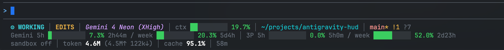

<p align="center">
  
</p>

<h1 align="center">Statusline HUD</h1>

<p align="center">
  <a href="./README.md">English</a> | 简体中文
</p>

<p align="center">
  面向 <a href="https://antigravity.google/docs/cli/statusline">Antigravity CLI (<code>agy</code>)</a> 的轻量自适应多行 HUD 状态栏（<code>scripts/statusline.sh</code>）与交互式 <code>/hud</code> 初始化/配置插件。<br />
  纯 Bash + <code>jq</code> · 零构建 · 热渲染约 20ms · 全模块 JSON 可配置。
</p>

> [!NOTE]
> 仅适用于 **Antigravity CLI (`agy`)**（支持 Linux、macOS 及 Windows WSL）；Antigravity App 桌面端与 IDE 扩展不渲染自定义 TUI 状态栏。

## 效果预览



**默认宽屏工作态（3 行紧凑视图；如需顶部会话标题行可开启 `showTitle: true`）**

```text
  ⚙ WORKING │ EDITS │ Gemini 4 Neon (XHigh) │ ctx ██░░░░░░░░ 19.7% │ ~/projects/antigravity-hud │ main* !1 ?7
  Gemini 5h █░░░░░░░░░ 7.3% 2h44m / week ██░░░░░░░░ 20.3% 5d4h │ 3P 5h ░░░░░░░░░░ 0.0% 5h0m / week █████░░░░░ 52.0% 2d23h
  artifacts 2 │ subagents 1/2 │ tasks 1 │ token 4.6M (4.5M↑ 122k↓) │ cache 95.1% │ 58m │ ~$0.42
```

**等待审批 + 中宽屏双额度（按可见列宽自动去条防折行）**

```text
  ⚠ CONFIRM (+1) │ EDITS [N] │ Gemini 4 Neon (XHigh) │ ctx ██░░░░░░░░ 24.5% │ …/antigravity-hud │ main*
  Gemini 5h 18.0% (1h0m) / week 7.0% (6d11h) │ 3P 5h 30.0% (2h0m) / week 15.0% (4d15h)
  subagents 0/2 │ sandbox ON │ token 268k (261k↑ 7k↓) │ cache 76.7% │ 14m │ ~$0.42
```

**初始会话（无配额与零值指标自动折叠为干净单行）**

```text
  ● READY │ Gemini 4 Neon (XHigh) │ ctx ░░░░░░░░░░ 0.0% │ ~/projects/antigravity-hud │ main*
```

## 快速开始

1. **安装插件**

   ```bash
   agy plugin install https://github.com/linbo0518/antigravity-hud
   ```

2. **通过 `/hud` 完成初始化与定制**

   打开 `agy`，输入 **`/hud`**（或直接说「帮我初始化状态栏」），即可自动体检依赖、预览效果并完成启用与布局定制；也可直接运行以下命令跳过向导立即启用：

   ```text
   /statusline ~/.gemini/config/plugins/statusline-hud/scripts/statusline.sh
   ```

> **升级方式**：随时重新运行 `agy plugin install https://github.com/linbo0518/antigravity-hud` 即可更新，个人配置统一保存在 `~/.config/statusline-hud/config.json`，升级零冲突。

<details>
<summary>备选：手动拷贝单脚本安装（不含 <code>/hud</code> 技能）</summary>

```bash
cp scripts/statusline.sh ~/.gemini/antigravity-cli/statusline.sh
chmod +x ~/.gemini/antigravity-cli/statusline.sh
```

在 Antigravity CLI 中执行 `/statusline ~/.gemini/antigravity-cli/statusline.sh`，或手动写入 `~/.gemini/antigravity-cli/settings.json`：

```json
{
  "statusLine": {
    "type": "command",
    "command": "~/.gemini/antigravity-cli/statusline.sh"
  }
}
```

</details>

## 唯一交互入口：`/hud`

`/hud` 是本插件初始化、校验、定制、预览、重置与排障的统一入口——**既可直接输入 `/hud` 命令，也可直接用自然语言对话**（例如「帮我初始化状态栏」「检查 HUD 配置有没有问题」「开启标题行并隐藏费用」）：

| 命令 / 对话示例 | 作用 |
| --- | --- |
| `/hud` | 体检 `jq`、脚本权限、`settings.json` 与 `config.json`，渲染实时预览，并通过清晰的无歧义交互提问切换预设或按项开关模块 |
| `/hud setup`（或「帮我初始化状态栏」） | 校验依赖与 `settings.json`（含 `enabled`、`stack_with_default` 及既有命令冲突检测），引导执行 `/statusline` 立即生效或经确认后原子写入 `settings.json` |
| `/hud check`（或「校验 HUD 配置」） | 校验 `config.json` 语法、未知字段名、错误类型与脚本冒烟运行，快速定位状态栏异常 |
| `/hud switch to compact layout`（或自然语言） | 校验字段后原子写入 `config.json`（如「开启标题行并隐藏路径」「关闭 3P 额度和费用」）并立即刷新预览 |
| `/hud reset` | 清除个人覆盖项，恢复出厂默认布局 |
| `/hud uninstall` | 引导先恢复默认状态栏（`/statusline delete`）再安全卸载插件 |

## 唯一配置入口：`config.json`

`${XDG_CONFIG_HOME:-~/.config}/statusline-hud/config.json` 是全部 HUD 偏好的唯一配置源。零配置即可开箱使用；无论通过 `/hud` 还是直接编辑，改动均在下一次状态刷新自动热生效，无需重启 `agy`。所有字段均可选，缺省或非法 JSON 会安全回退默认值：

| 字段 | 类型 / 可选值 | 默认值 | 说明 |
| --- | --- | --- | --- |
| `preset` | `"standard"` \| `"compact"` \| `"minimal"` | `"standard"` | `"standard"` 自适应多行；`"compact"` 始终隐藏进度条并保留自适应指标；`"minimal"` 仅 Line 1 |
| `showTitle` | boolean | `false` | 在有会话标题时于顶部显示标题行 `▸ Title`（`"minimal"` 预设下隐藏） |
| `showMode` | boolean | `true` | 显示 `cycle_mode`（`PLAN` / `EDITS` / `AUTO`）与 Vim 模式 |
| `showPath` | boolean | `true` | 显示 Line 1 当前工作目录路径 |
| `showGit` | boolean | `true` | 显示 Line 1 Git 分支与变更指标 |
| `showQuota` | boolean | `true` | 显示 Line 2 额度行 |
| `show3pQuota` | boolean | `true` | 显示 3P 额度 |
| `showActivity` | boolean | `true` | 显示 Line 3 活动计数（`artifacts`、`subagents`、`tasks`） |
| `showSandboxOff` | boolean | `false` | 未开启沙箱时是否仍显示 `sandbox off`（开启沙箱时始终高亮提示 `sandbox ON`） |
| `showTokens` | boolean | `true` | 显示会话 Token 总量与输入/输出拆解 |
| `showCache` | boolean | `true` | 显示缓存命中率 |
| `showDuration` | boolean | `true` | 显示会话已持续时间 |
| `showCost` | boolean | `true` | 显示预估费用 |

示例（`~/.config/statusline-hud/config.json`）：

```json
{
  "preset": "standard",
  "showTitle": true,
  "show3pQuota": false,
  "showCost": false
}
```

## 核心特性

- **原生协议完整映射**：覆盖 `idle` / `working` / `tool_use` / `reviewing` / `error` / `authenticating` / `initializing` 状态，高优先级提示 `tool_confirmation_pending` 与排队输入 `(+N)`，展示 `cycle_mode`（`PLAN` / `EDITS` / `AUTO`）、可选 Vim 模式及可选会话标题行。
- **全宽自适应防折行**：所有行均按精确 Unicode 列宽（兼容中英文路径、分支、标题与常见 Emoji）对照 `terminal_width` 逐级降级——优先缩模型名与路径、保留高风险权限模式指示，自动去进度条与折叠空行，60–80 列分屏下也不折行撑乱 TUI。
- **准确的会话统计**：
  - `subagents` 按 `running/total` 区分运行中与已完成子代理。
  - 从 `transcript.jsonl` 累计会话真实 Token（兼容 rewind 复用 `step_index`）、整场缓存命中率与会话时长，按 `mtime + size` 缓存结果；transcript 尚未落盘时自动回退至 `context_window.current_usage`。
- **高性能、安全与跨平台**：单次 `jq` 解析（连同 `config.json` 一并读入并容错）、清洗标题与分支中的 ANSI/控制字符、查表进度条（免疫 `LC_ALL=C` 乱码）、Bash outvar 零子进程拼接、`git status --no-optional-locks` 2 秒 TTL 缓存与超时保护、7 天旧缓存自动清理，兼容 Linux 与 macOS（Bash 3.2 + BSD `stat`）。

## 符号说明

- **Git 状态**：`*` 工作区有改动，`↑N` / `↓N` 领先 / 落后上游提交数，`!N` 修改或冲突，`+N` 新增，`✘N` 删除，`?N` 未跟踪文件。
- **配额**：百分比表示**已用比例**（绿色 `<60%`、黄色 `60–89%`、红色 `>=90%`），后接距重置剩余时间；仅返回剩余数量的配额会明确标注 `<N> left`。
- **Token**：`token <总量> (<输入>↑ <输出>↓)`，按整场会话累计。

## 依赖

- Antigravity CLI (`agy`)
- `bash`（3.2+）
- `jq`（1.6+）
- `git`（可选，用于分支与脏状态检测）

## 卸载与恢复默认

卸载插件前请**先恢复默认状态栏**，避免脚本删除后 CLI 反复调用失败：

1. 在 Antigravity CLI 中执行 `/statusline delete`。
2. 在终端执行：

```bash
agy plugin uninstall statusline-hud
rm -rf "${XDG_CONFIG_HOME:-$HOME/.config}/statusline-hud" "${XDG_CACHE_HOME:-$HOME/.cache}/statusline-hud"  # 可选：清理配置与缓存
```

## 缓存、验证与调试

- 运行缓存位于 `${XDG_CACHE_HOME:-~/.cache}/statusline-hud/`（按 `git/` 与 `transcript/` 隔离，超过 7 天的过期文件会自动低频清理）。
- 运行内置回归测试与官方插件校验：

```bash
./tests/test.sh
agy plugin validate --strict .
```

## 致谢（Acknowledgments）

本项目的设计与实现深受以下优秀开源项目与官方示例的启发，向原作者与维护者致以诚挚感谢：

- **[claude-hud](https://github.com/jarrodwatts/claude-hud)**（by Jarrod Watts，MIT License）：启发了多行 HUD 的信息组织方式、可读性优先的视觉层次，以及通过 `/hud` 交互式配置与预览的产品体验。
- **[Google Antigravity CLI 官方 `statusline` 示例](https://github.com/google-antigravity/antigravity-cli/tree/main/examples/statusline)**：提供了标准 16 色配色基调、单次 `jq` 解析的轻量化思路以及 Antigravity CLI 状态协议参考实现。

## License

[MIT](./LICENSE)
